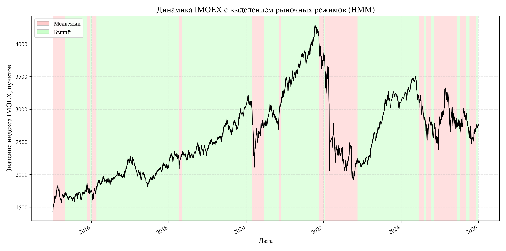
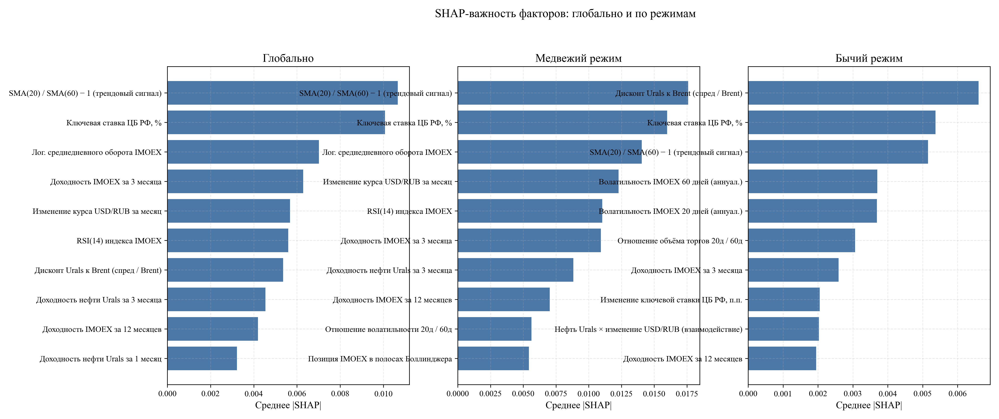

<<<<<<< HEAD
# Режимно-адаптивный анализ фондового рынка РФ методами машинного обучения

Практическая часть выпускной квалификационной работы. Исследование проверяет, что российский фондовый рынок переключается между скрытыми режимами, и что ML-модель, учитывающая текущий режим, прогнозирует направление индекса МосБиржи точнее единой модели. С помощью SHAP показано, что в разных режимах рынком управляют разные факторы.

**Задача:** бинарная классификация — вырастет ли индекс IMOEX в следующем месяце.

```
y(t+1) = 1, если доходность IMOEX за месяц t+1 > 0, иначе 0
```

Одно наблюдение — один месяц, период январь 2015 — декабрь 2025 (132 месяца).

## Данные

| Ряд | Источник |
|-----|----------|
| IMOEX, дневные OHLCV | MOEX ISS API |
| USD/RUB | MOEX ISS API / ЦБ РФ |
| RGBI | MOEX ISS API |
| Ключевая ставка ЦБ РФ | cbr.ru |
| Нефть Urals | Investing.com (CSV, загружается вручную) |
| Нефть Brent | yfinance, `BZ=F` (только для спреда Urals–Brent) |

Сырые ряды лежат в `data/raw/`. Промежуточные данные (`data/processed/`) создаются скриптами пайплайна.

## Методология

1. **Признаки.** 25 месячных признаков на последний торговый день месяца: доходности IMOEX за разные горизонты, волатильность (в т.ч. условная GARCH(1,1)), объём, технические индикаторы, нефть Urals, курс, ключевая ставка, RGBI и их взаимодействия. Используются только данные до момента t.
2. **Эконометрика.** Описательная статистика, тесты ADF/KPSS, GARCH(1,1), VAR/SVAR (тест Грейнджера, IRF, FEVD).
3. **Режимы.** Скрытая марковская модель (GaussianHMM) на дневных доходности, волатильности и объёме; число состояний выбирается по BIC.
4. **Baseline.** 8 моделей без учёта режимов: логистическая регрессия, SVM, Random Forest, XGBoost, CatBoost, LSTM, TFT, TabTransformer. Гиперпараметры подбираются Optuna.
5. **Режимные модели.** Вариант A — лучшая baseline-модель, обученная отдельно на каждом режиме; вариант B — ансамбль, взвешенный вероятностями режимов; вариант C — лучшая модель для каждого режима.
6. **Интерпретация.** SHAP глобально, по режимам и в скользящем окне; сопоставление SHAP с FEVD из VAR.
7. **Гипотезы H1–H7.** Тесты Diebold–Mariano, Kruskal–Wallis, ранговая корреляция Спирмена.
8. **Улучшение.** Калибровка, подбор порога, блендинг и stacking прогнозов.

Валидация — walk-forward с расширяющимся окном: обучение с 2015 года, тест с февраля 2020 по ноябрь 2025 (70 фолдов), зазор между обучением и тестом 1 месяц. HMM переобучается на каждом шаге только на данных до прогнозного месяца, поэтому заглядывания в будущее нет. `random_state = 42` везде.

## Основные результаты

HMM выделила два режима: «бычий» (72% торговых дней, годовая доходность +16%, волатильность 14%) и «медвежий» (28%, −7%, волатильность 39%).



| Система | AUC-ROC | Accuracy | F1 macro | Доходность стратегии |
|---------|--------:|---------:|---------:|---------------------:|
| Buy & Hold | — | — | — | −0,7% |
| SVM (лучший baseline) | 0,559 | 0,600 | 0,375 | −0,7% |
| Вариант A (SVM по режимам) | 0,597 | 0,629 | 0,448 | +23,0% |
| Вариант C (лучшая модель на режим) | 0,536 | 0,643 | 0,591 | +23,9% |
| Блендинг (softmax по AUC) | 0,627 | 0,600 | 0,433 | +15,0% |
| Жёсткое переключение по режиму | 0,622 | 0,643 | 0,580 | +21,2% |

Доходность стратегии — накопленная за тестовый период: при прогнозе роста позиция в IMOEX, иначе в кэше.

Проверка гипотез:

| Гипотеза | Результат |
|----------|-----------|
| H1. Режимная модель лучше baseline | частично (выше AUC, DM-тест p = 0,24) |
| H2. SHAP-вклады различаются между режимами | подтверждена (p < 0,001) |
| H3. В разных режимах доминируют разные факторы | частично (пересечение top-5 — 2 фактора) |
| H4. Наибольший выигрыш — в кризисном режиме | подтверждена |
| H5. VAR согласуется с SHAP | не подтверждена |
| H6. XGBoost лучше TFT и TabTransformer | подтверждена (DM, поправка Холма) |
| H7. Вариант C лучше варианта A | не подтверждена |



## Структура проекта

```
config.py              все параметры исследования
requirements.txt
src/
  01_data_collection.py         сбор данных, fig_01–05
  03_feature_engineering.py     25 признаков и целевая, fig_06–09, T1–T2
  04_descriptive_analysis.py    описательная статистика, fig_10–16, T3–T6
  05_stationarity_garch.py      ADF/KPSS, GARCH(1,1)
  06_var_svar.py                VAR/SVAR, IRF, FEVD, fig_17–23, T7–T10
  07_regime_detection.py        HMM-режимы, fig_24–31, T11–T13
  08_baseline_models.py         8 baseline-моделей, fig_32–43, T14–T17
  08a_baseline_diagnostics.py   диагностика baseline
  09a_walk_forward_regimes.py   HMM в режиме walk-forward
  09_regime_models.py           режимные модели A, B, C
  09b_regime_metrics_figures.py метрики и графики режимных моделей, fig_44–55, T18–T22
  10_shap_analysis.py           SHAP, fig_56–68, T23
  10b_var_shap_validation.py    FEVD vs SHAP, fig_69–70
  11_hypothesis_testing.py      гипотезы H1–H7, fig_71–73
  12_final_visuals.py           итоговые графики, fig_74–76
  13_model_improvement.py       калибровка, блендинг, stacking, fig_77–82
  14_shap_improved.py           SHAP улучшенной модели, fig_83–87
  feature_utils.py, utils.py    общие функции
data/raw/              исходные ряды
figures/               графики (PNG, 300 dpi)
tables/                таблицы результатов (CSV)
```

## Запуск

```bash
python -m venv .venv
source .venv/bin/activate
pip install -r requirements.txt
```

Скрипты запускаются из корня проекта по порядку:

```bash
python src/01_data_collection.py
python src/03_feature_engineering.py
python src/04_descriptive_analysis.py
python src/05_stationarity_garch.py
python src/06_var_svar.py
python src/07_regime_detection.py
python src/08_baseline_models.py
python src/08a_baseline_diagnostics.py
python src/09a_walk_forward_regimes.py
python src/09_regime_models.py
python src/09b_regime_metrics_figures.py
python src/10_shap_analysis.py
python src/10b_var_shap_validation.py
python src/11_hypothesis_testing.py
python src/12_final_visuals.py
python src/13_model_improvement.py
python src/14_shap_improved.py
```

